# Sistema de Gestão de Contratos de Publicidade e Execução Orçamentária

## Case Study

Este projeto documenta a concepção e o desenvolvimento de um sistema para gestão do ciclo orçamentário, financeiro, documental e operacional de contratos de publicidade em um órgão público estadual.

O objetivo deste repositório é apresentar a arquitetura da solução, as decisões de produto, as regras de negócio e os principais desafios enfrentados durante o desenvolvimento. O código-fonte não é disponibilizado.

> **Atualização (novembro/2026).** O que começou como o controle das notas fiscais de publicidade cresceu para o ciclo completo: do orçamento ao pagamento, com declaração de retenções, transparência e caminho de volta controlado. O sistema está em produção e em uso pela equipe desde outubro de 2026. A seção [Evolução](#evolução-desde-a-primeira-versão) resume o que mudou.

## Contexto

O processo era integralmente controlado por planilhas eletrônicas.

Planos financeiros, notas fiscais, checklists de conformidade, atestados, ofícios, empenhos, reservas e pagamentos eram administrados manualmente, distribuídos em diversos arquivos independentes, sem integração, rastreabilidade ou regras automatizadas.

Além da complexidade operacional, o processo precisava atender requisitos típicos da administração pública:

- rastreabilidade das decisões;
- histórico completo de alterações;
- segregação de responsabilidades;
- conformidade documental;
- auditoria;
- acompanhamento de prazos legais.

O desafio não era apenas informatizar um processo existente, mas transformar um conjunto de rotinas administrativas em um sistema consistente, auditável e preparado para evoluir.

## Abordagem

Este projeto foi conduzido a partir da modelagem do processo de negócio.

Antes da implementação, foram mapeadas as etapas operacionais, identificadas as regras de negócio, definidos os fluxos, estados, exceções, permissões, indicadores e critérios de auditoria. As regras foram validadas com a área **uma a uma**, antes de virarem código: nenhuma regra de negócio entrou no sistema sem confirmação explícita de quem a executa no dia a dia.

Outro princípio: **fidelidade ao processo real**. Onde a planilha da equipe fazia algo de um jeito, o sistema primeiro reproduz esse jeito; só depois propõe melhorias, e sempre com aprovação.

A implementação utilizou ferramentas de desenvolvimento assistido por inteligência artificial como aceleradoras do processo de engenharia. A IA foi empregada como ferramenta de desenvolvimento, enquanto todas as decisões relacionadas à arquitetura, modelagem, regras de negócio, experiência do usuário e validação funcional permaneceram orientadas pelo conhecimento do domínio e pela evolução contínua do produto.

Mais do que demonstrar o desenvolvimento de um software, este projeto procura ilustrar uma forma de trabalho baseada na combinação entre análise de processos, engenharia de produto e utilização estratégica de inteligência artificial para acelerar a construção de soluções complexas.

## Evolução desde a primeira versão

| Antes | Agora |
|---|---|
| Controle das notas fiscais de publicidade | Ciclo completo: orçamento, planos, notas, análise, atestados, liquidação, pagamento, REINF e transparência |
| Alteração com aprovação | Alteração com aprovação **e caminho de volta**: cada etapa (ordem bancária, programação de desembolso, assinatura, atestado, análise) pode ser desfeita, de trás para a frente, com aprovação do coordenador do módulo responsável |
| Pagamento único por documento | **Complemento de pagamento**: corrige uma retenção de imposto feita a maior, sem mexer no documento original nem no valor do plano |
| Dados novos apenas | **Carga histórica** das planilhas de vários anos, em duas camadas: a cópia fiel do original e a camada operacional |
| Painéis de publicidade | Painéis **Executivo** e **Operacional do Orçamentário**, com a cascata dotação → saldo disponível e conferência automática dos totais |
| Validação da nota contra o plano | Validação, **aviso sem bloqueio** quando a nota nova diverge do que a planilha histórica dizia, e detecção de duplicidade |

## Principais funcionalidades

### Gestão completa do ciclo operacional

O sistema acompanha integralmente o fluxo de execução dos contratos:

```
Orçamento (dotação, reserva, empenho)
        ↓
Plano Financeiro
        ↓
Nota Fiscal
        ↓
Checklist de Conformidade
        ↓
Atestado ou Ofício
        ↓
Programação de Desembolso
        ↓
Ordem Bancária (pagamento)
        ↓
REINF · Transparência
```

Cada documento permanece vinculado ao mesmo processo durante todo o ciclo de vida.

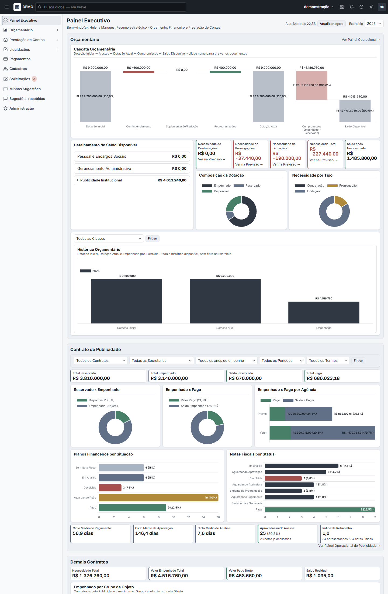

*Painel Executivo: a cascata orçamentária, o contrato de publicidade e a prestação de contas num só lugar.*

### Orçamento e saldo disponível

Dotações, notas de crédito, reservas e empenhos são lançados com seus movimentos (original, reforço, anulação) e o saldo disponível é calculado pelo sistema, do orçamento da unidade à unidade gestora. O painel mostra o selo **"Confere"** quando a conta fecha, e avisa onde há diferença.

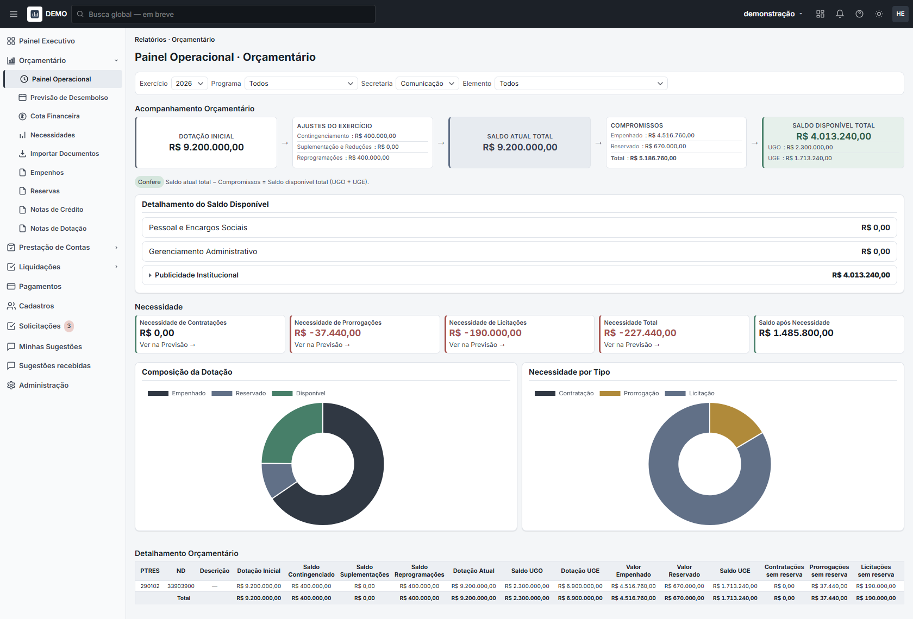

*Painel Operacional do Orçamentário: dotação inicial, ajustes, compromissos e saldo disponível, com os valores da dotação e do crédito.*

### Validação automática de conformidade

A Nota Fiscal é validada automaticamente contra o Plano Financeiro correspondente.

São verificadas, entre outras informações:

- Secretaria
- Agência
- Campanha
- Empenho
- Fornecedor
- Valores e retenções
- Aplicação
- Identificadores do processo

Divergências impedem a aprovação da análise. Quando a nota é nova e o plano veio de uma planilha histórica, a diferença com o que a planilha dizia aparece como **aviso**, sem bloquear, e fica registrada se o analista decidir seguir.

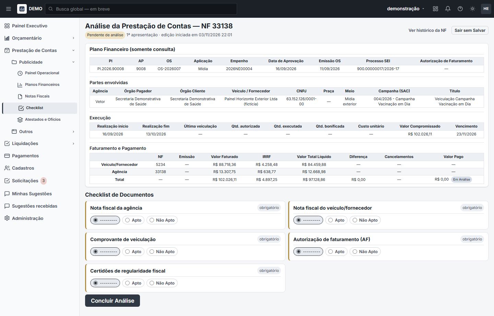

*Análise da prestação de contas: o plano ao lado, o checklist de documentos abaixo.*

### Controle de SLA

O sistema acompanha automaticamente o prazo entre o recebimento da Nota Fiscal e a assinatura do Atestado.

Os indicadores são separados entre a Secretaria de Comunicação e as demais Secretarias; cada grupo tem metas próprias de atendimento e classificação automática por faixas de SLA.

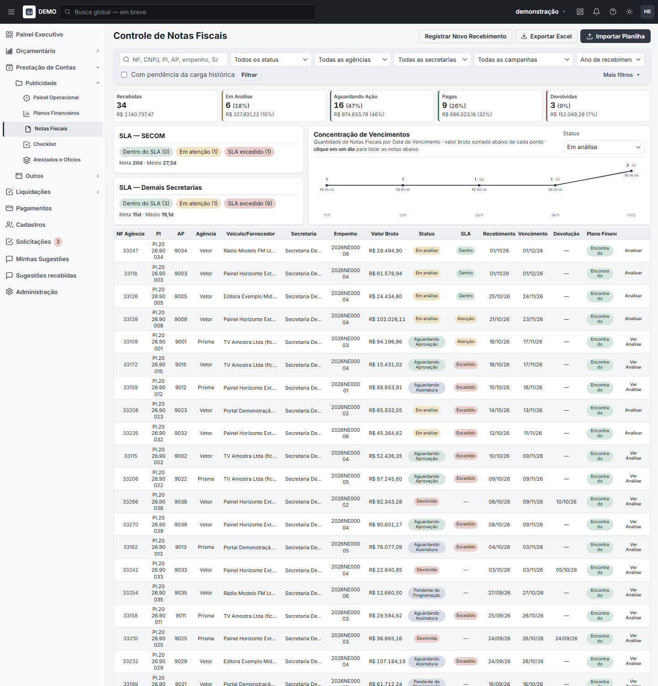

*Controle de Notas Fiscais: SLA por grupo e concentração de vencimentos.*

### Gestão automática de vencimentos

Datas de vencimento são recalculadas automaticamente considerando:

- finais de semana;
- feriados cadastrados (inclusive mudanças por decreto, que reprocessam as notas afetadas);
- regras específicas do processo.

### Emissão de documentos institucionais

O sistema gera automaticamente Atestados e Ofícios, em PDF e em texto pronto para o processo eletrônico, a partir de modelos institucionais parametrizados pelos dados do processo. As notas são reunidas em **lotes** (mesma agência, empenho e vencimento) e o sistema indica o que está completo, parcial ou aguardando análise.

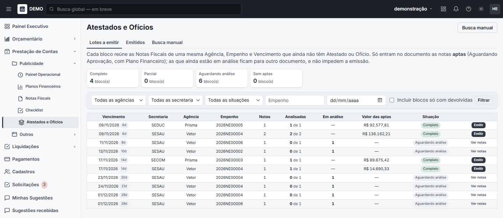

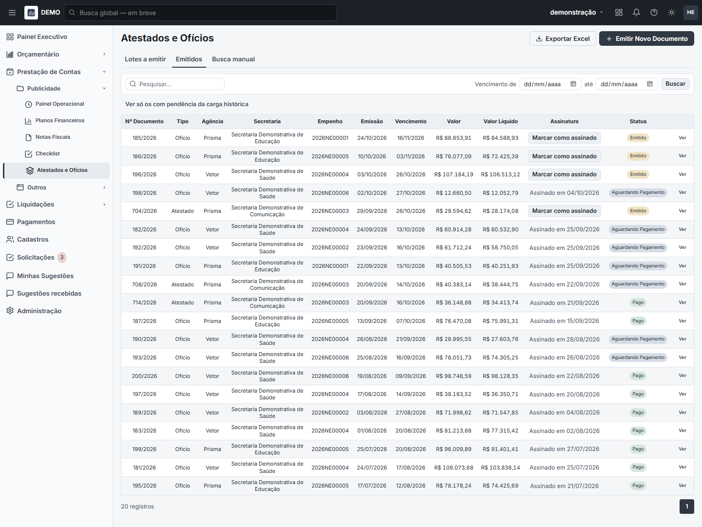

### Caminho de volta controlado

Errar faz parte; o que importa é corrigir sem apagar o passado. Cada etapa pode ser desfeita **de trás para a frente**, por um pedido que o coordenador do módulo responsável aprova ou rejeita, e tudo fica no histórico. Quando o erro é uma retenção de imposto feita a maior, o **complemento de pagamento** paga a diferença sem alterar o documento original.

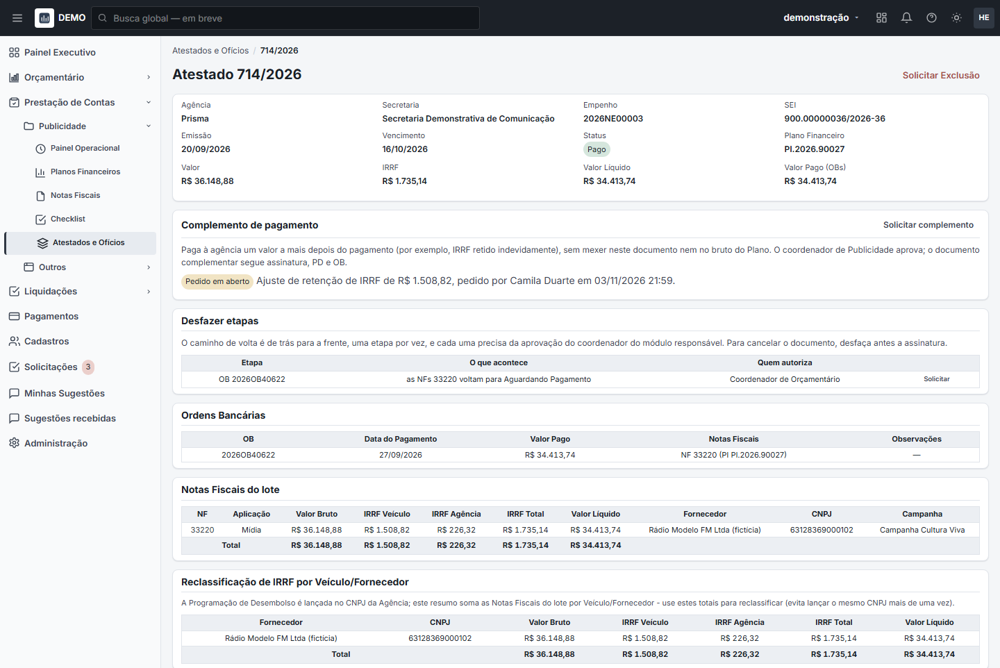

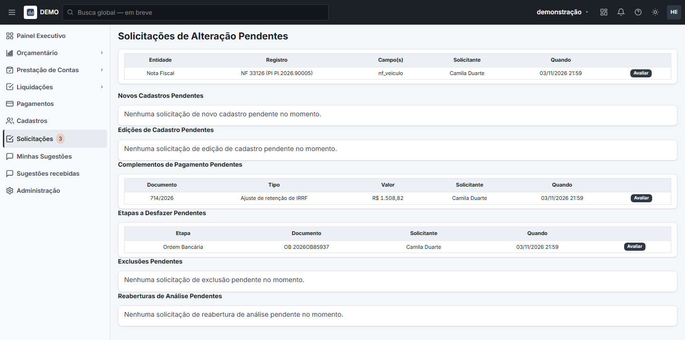

### Rastreabilidade de ponta a ponta

Cada nota tem a sua linha do tempo: recebimento, checklist, ofício ou atestado, assinatura e pagamento. Toda correção gera uma nova versão do registro e preserva a anterior, com autor, justificativa e valores antes e depois.

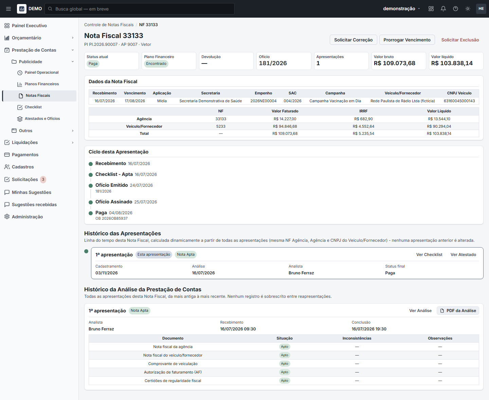

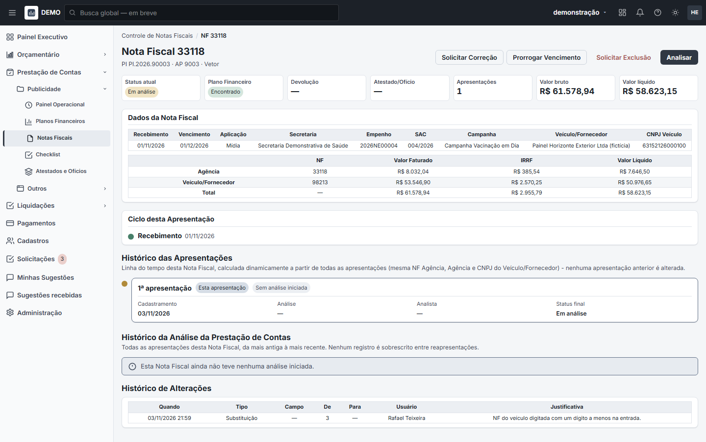

### Liquidações, REINF e Transparência

A programação de desembolso, a ordem bancária e a declaração das retenções (REINF) saem dos mesmos dados do pagamento: o relatório mensal que a equipe montava à mão passou a ser gerado e exportado pelo sistema, conferido contra o relatório anterior. A tela de Transparência confronta o que foi pago com o portal público.

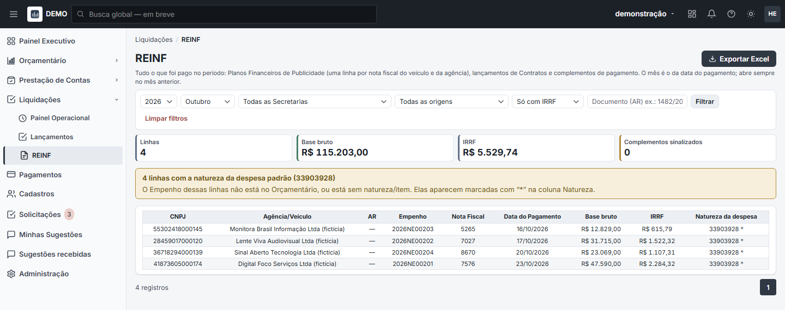

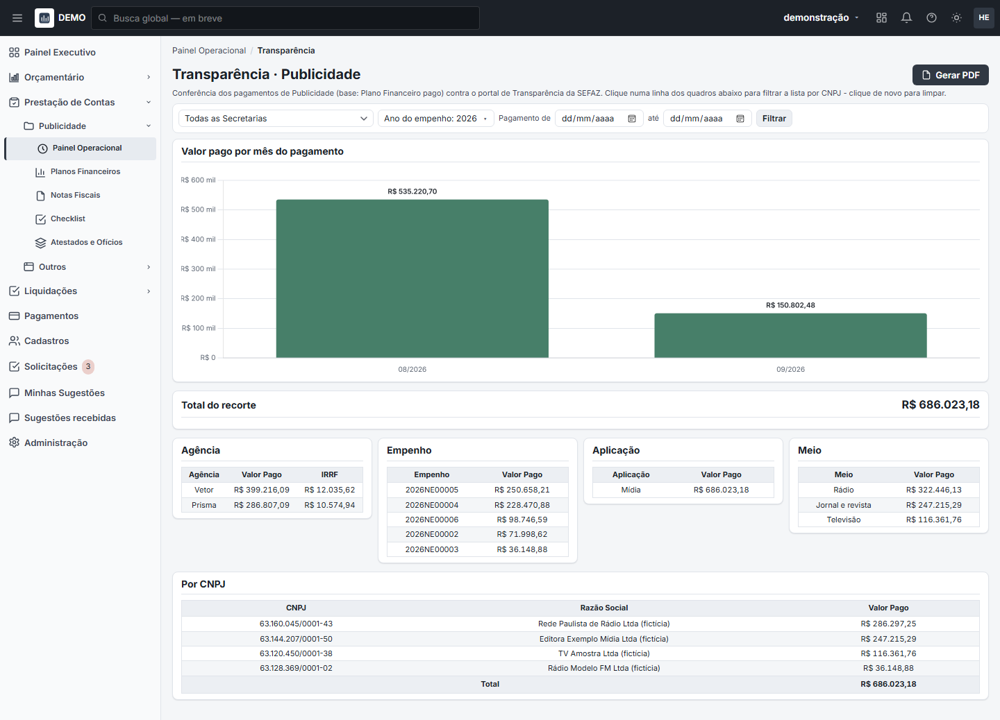

### Importação de planilhas

Planilhas Excel podem ser importadas para o sistema. As mesmas regras utilizadas na entrada manual são aplicadas durante a importação, evitando tratamentos diferentes entre processos automatizados e operações realizadas pelo usuário.

A carga das planilhas históricas de vários anos usa duas camadas: o dado **original**, preservado sem alteração, e o dado **operacional**, que o sistema usa e corrige. É o que permite mostrar, mais tarde, o que a planilha dizia e o que mudou.

### Dashboards operacionais

O sistema fornece indicadores para acompanhamento de produtividade, situação operacional, pagamentos, SLA, distribuição financeira e pendências. Gráficos e indicadores são integrados por filtros.

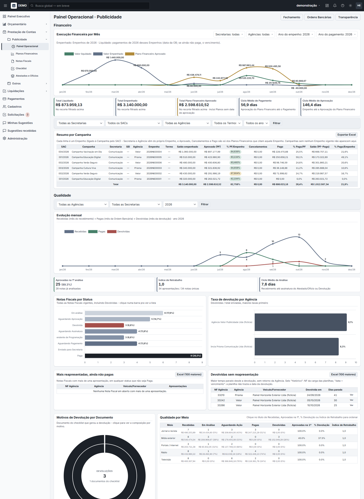

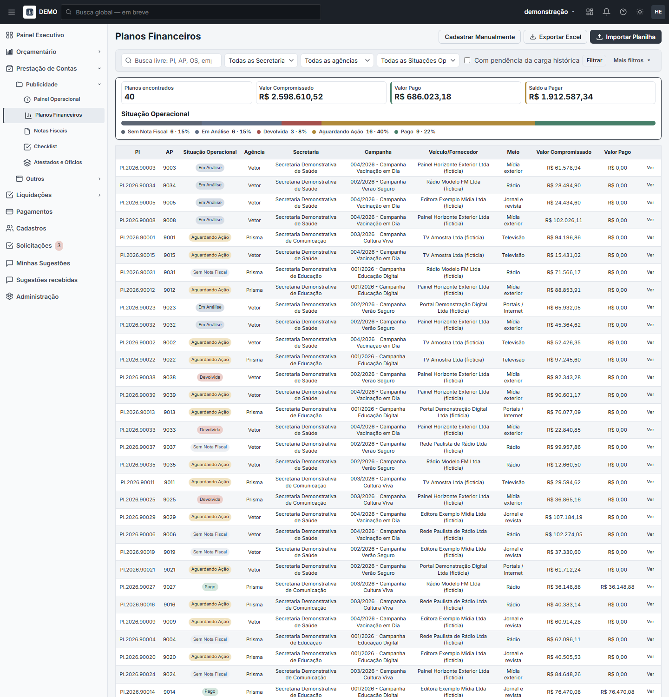

### Tema claro e escuro

A interface tem tema claro e escuro, escolhidos pelo usuário, e as duas versões usam os mesmos Design Tokens: nenhuma tela tem cor própria fora do sistema de design.

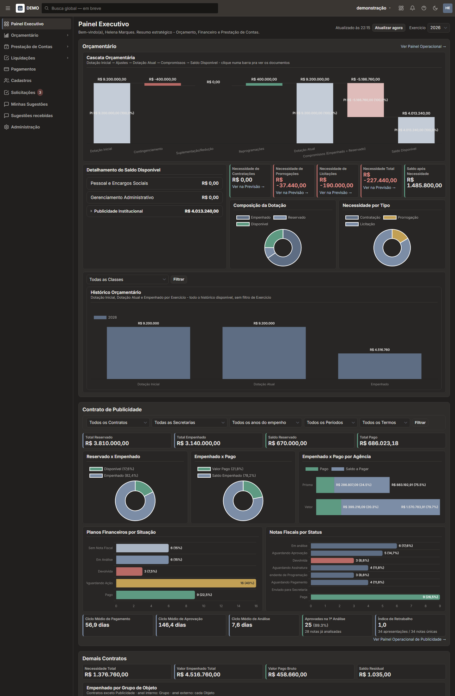

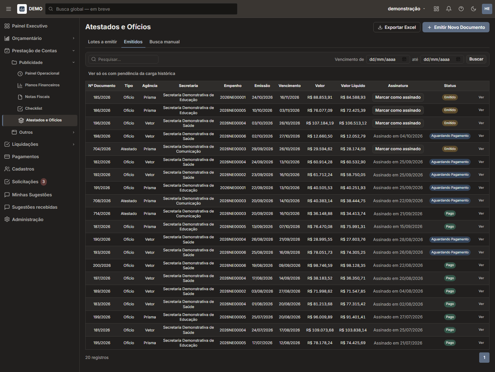

## Decisões de engenharia

### Auditoria como requisito estrutural

A auditoria foi concebida como parte da arquitetura do sistema. Todos os registros financeiros possuem histórico completo de alterações, preservando rastreabilidade e trilha de auditoria.

### Alterações críticas controladas

Campos sensíveis não podem ser alterados diretamente. Qualquer modificação gera uma Solicitação de Alteração que percorre um fluxo próprio de aprovação, registrando solicitante, aprovador, justificativa e histórico completo da operação. Ninguém aprova o próprio pedido, e a autoridade de aprovação segue o módulo do dado.

### Regras de negócio centralizadas

As regras responsáveis por cálculos, validações e classificações permanecem isoladas da interface. Isso permite reutilização entre telas, importação de planilhas, geração de documentos, dashboards e validações futuras.

### Desempenho medido, não presumido

Em produção, o uso real revelou gargalos que os testes não mostraram. Uma consulta que montava um filtro com dezenas de milhares de pares de valores chegou a travar o servidor por mais de 30 minutos; foi reescrita como agregação. O planejador do banco gastava mais de um segundo por consulta com otimização antecipada ligada, que foi desativada. Relatórios que levavam 16 segundos passaram a 4 segundos a frio e menos de 1 segundo em cache, com o cache aquecido por tarefa agendada. Um teste de carga com usuários simulados, com tempo de espera entre ações, acompanhou cada mudança.

### Qualidade

Mais de 600 testes automatizados cobrem as regras de negócio, as telas e os comandos de manutenção de dados. Correções em dados de produção sempre começam por uma **simulação** que mostra o que seria alterado; só depois de conferida é que se grava, com backup e registro de auditoria.

### Design System próprio

Toda a interface foi construída sobre um Design System baseado em Design Tokens (CSS Custom Properties), com tema claro e escuro. Essa abordagem garante consistência visual entre todos os módulos sem dependência de frameworks CSS de terceiros.

### Infraestrutura única

O mesmo artefato Docker é utilizado nos ambientes de desenvolvimento, homologação e produção. As diferenças entre ambientes são tratadas exclusivamente por configuração.

### Ambiente de demonstração reproduzível

As telas deste repositório saem de um ambiente de demonstração com **banco próprio e dados totalmente fictícios**, gerados por um comando com semente fixa. Quando o sistema muda de forma relevante, basta recriar o ambiente e refazer as capturas (também automáticas): as imagens deste case sempre refletem a versão atual, sem expor nenhum dado institucional.

## Arquitetura

```
                              Usuário
                                │
                         Navegador (HTTPS)
                                │
                                ▼
                        ┌───────────────┐
                        │     Nginx     │
                        └───────┬───────┘
                                │
                                ▼
                    ┌────────────────────────┐
                    │ Django + Gunicorn      │
                    └──────┬───────────┬─────┘
                           │           │
                           ▼           ▼
                     PostgreSQL      Redis
```

A infraestrutura utiliza Docker Compose para orquestração dos serviços, comunicação por rede interna entre containers e renovação automática de certificados TLS através do Let's Encrypt. O Redis guarda o cache dos painéis, aquecido por tarefa agendada.

## Stack tecnológica

- Python
- Django
- PostgreSQL
- Redis
- Gunicorn
- Nginx
- Docker
- Docker Compose
- Let's Encrypt
- HTML
- CSS (Design System próprio)
- JavaScript (HTMX e Chart.js)

## O que este projeto demonstra

Além da implementação técnica, este projeto procura demonstrar uma abordagem para desenvolvimento de software orientada por domínio, onde a tecnologia atua como meio para resolver problemas de negócio.

O foco esteve na compreensão do processo, na modelagem das regras operacionais e na construção de uma solução capaz de transformar um fluxo administrativo complexo em um sistema consistente, auditável e preparado para evolução contínua.

## Imagens

As telas apresentadas utilizam exclusivamente dados fictícios. Nenhuma informação institucional ou processo administrativo real é exibido neste repositório.
